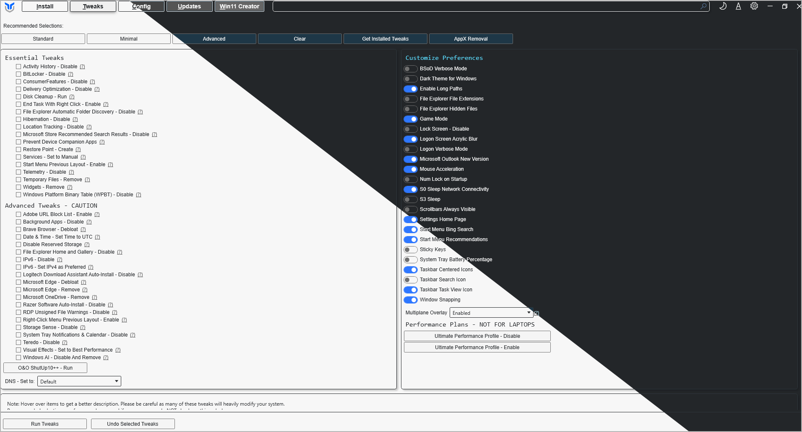

# CemWinUtility (Windows Yardımcı Programı)

[](https://github.com/ChrisTitusTech/winutil/releases/latest)

[](https://discord.gg/RUbZUZyByQ)

Windows kurulumlarını kolaylaştırmak (**yüklemeler**), sistemi sadeleştirmek (**ince ayarlar**), sorunları gidermek (**yapılandırma**) ve **Windows güncellemelerini** yönetmek için özenle derlenmiş sistem görevleri koleksiyonu. Her yeni Windows kurulumunda temiz bir başlangıç için çalıştırın.




---

## Hızlı Başlangıç

> **CemWinUtility, sistem genelinde değişiklikler gerçekleştirdiği için Yönetici olarak çalıştırılmalıdır.**

PowerShell veya Terminal'i yönetici olarak açın ve çalıştırın:

**Kararlı Sürüm (Önerilen)**
```ps1
irm https://christitus.com/win | iex
```

**Geliştirici Sürümü**
```ps1
irm https://christitus.com/windev | iex
```

### Yönetici Terminali Nasıl Açılır?

- **Başlat menüsü:** Başlat'a sağ tıklayın → *Windows PowerShell (Yönetici)* veya *Terminal (Yönetici)*
- **Arama:** `Windows tuşuna` basın, `PowerShell` veya `Terminal` yazın, ardından `Ctrl + Shift + Enter` tuşlarına basın

---

## Otomasyon / Ön Ayarlar (Presets)

Manuel seçim yapmadan önceden tanımlanmış bir yapılandırmayı uygulayın:

```powershell
& ([ScriptBlock]::Create((irm https://christitus.com/win))) -Preset Standard
```

| Ön Ayar | Açıklama |
|---------|----------|
| `Standard` | Çoğu kullanıcı için dengeli varsayılanlar |
| `Minimal` | Her kullanıcıya uygun minimum değişiklikler |
| `Advanced` | İleri düzey kullanıcılar için derinlemesine ince ayarlar |

Her bir ön ayarın tam olarak ne yaptığını görmek için:
https://github.com/ChrisTitusTech/winutil/blob/main/config/preset.json

---

## Derleme ve Geliştirme

Bkz: https://github.com/ChrisTitusTech/winutil/blob/main/.github/CONTRIBUTING.md

---

## Kaynaklar

- [Resmi Dokümantasyon](https://winutil.christitus.com/)
- [YouTube Eğitim Videosu](https://www.youtube.com/watch?v=6UQZ5oQg8XA)
- [ChrisTitus.com Makalesi](https://christitus.com/windows-tool/)
- [Bilinen Sorunlar](https://winutil.christitus.com/knownissues/)
- [Hata Bildir](https://github.com/ChrisTitusTech/winutil/issues)

---

## Destek

- Destek olmak için bir ⭐ bırakın! 😊
- Daha hızlı Dotnet sürümü burada satışta: https://www.cttstore.com/windows-toolbox

## Sponsorlar

Bu projeyi aylık katkılarıyla canlı tutan sponsorlarımız.

<!-- sponsors --><a href="https://github.com/dwelfusius"></a><a href="https://github.com/mews-se"></a><a href="https://github.com/jdiegmueller"></a><a href="https://github.com/robertsandrock"></a><a href="https://github.com/paulsheets"></a><a href="https://github.com/djones369"></a><a href="https://github.com/anthonymendez"></a><a href="https://github.com/FatBastard0"></a><a href="https://github.com/DursleyGuy"></a><a href="https://github.com/DwayneTheRockLobster1"></a><a href="https://github.com/KieraKujisawa"></a><a href="https://github.com/seanh1995"></a><a href="https://github.com/josencarnacao"></a><!-- sponsors -->

*<sub>Aboneliği devam eden sponsorlar ayrıca .NET alternatifine de erişebilir.</sub>

---

## Katkıda Bulunanlar

[](https://github.com/ChrisTitusTech/winutil/graphs/contributors)

Bu projeye zaman ve emek ayıran herkese teşekkürler. Harika iş çıkarmaya devam edin 🍻
